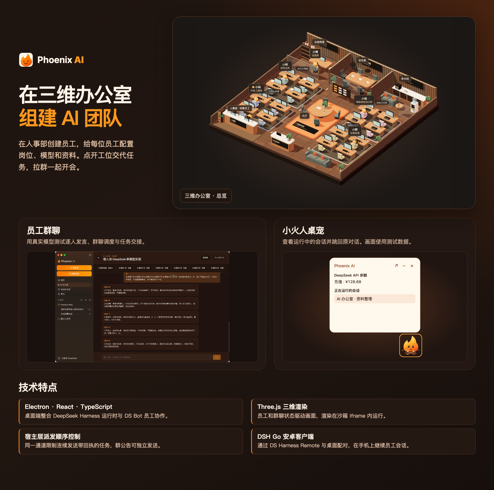

# Phoenix AI

**在桌面组建 AI 团队，在三维办公室里分派任务、开会和查看进度。**

Phoenix AI 是一个开源桌面工作台。你可以在普通会话里处理个人任务，也可以在人事部创建 AI 员工，为每位员工配置自己的岗位、模型和资料目录。点击工位即可打开对话，遇到需要配合的任务，可以拉群、定向 `@` 成员并收集回复。

桌面运行时基于 DeepSeek Harness，员工协作基于 DS Bot，Android 客户端基于 DSH Go。各项目的分工见下方技术特点与上游项目。

[下载 Windows x64 预发布版](https://github.com/cengxiangzuo-sys/phoenix-ai/releases/tag/phoenix-windows-bfd67e68) · [下载 macOS Apple Silicon 预发布版](https://github.com/cengxiangzuo-sys/phoenix-ai/releases/tag/phoenix-macos-f009fbae) · [反馈问题](https://github.com/cengxiangzuo-sys/phoenix-ai/issues)

## 可以用 Phoenix 做什么

| 场景 | 操作 |
| --- | --- |
| 组建团队 | 在三维人事部创建员工，为调研、写作、开发等岗位配置职责、工作指令、模型和资料目录。 |
| 跟进工作 | 在办公室旋转视角、缩放和切换楼层。员工读取文件、检索或写作时，画面显示对应状态。点员工可查看资料并进入会话。 |
| 开会和分工 | 用群聊安排任务，支持定向 `@`、管理员、公告和发言模式。会议状态可映射到三维会议室，单个视图最多显示 16 个席位。 |
| 处理个人项目 | 按工作区组织普通会话，引用文件和历史会话，查看上下文用量。可使用 Skills、插件和自动化任务。 |
| 手机接着指挥 | Android 与桌面配对后，可从手机端办公室打开员工会话、发任务和查回复。 |
| 随手看进度 | 打开小火人桌宠，点击即可查看和切回正在运行的会话。桌宠支持拖动、右键切换动画，并可显示已登录 DeepSeek 账户的余额。 |

## 快速开始

1. 打开 Phoenix AI，登录模型账户或配置已有的 API Key。
2. 个人任务点击「新会话」。需要多人协作时，进入「AI 办公室」，点击人事部创建员工。
3. 如需从手机继续，打开桌面端「连接手机」，按提示下载 Android 客户端并扫码配对。

GitHub Releases 提供 Windows x64 和 macOS Apple Silicon 预发布安装包，均附 SHA-256 校验文件。macOS 版采用临时签名，尚未通过 Apple 公证。Android 客户端通过桌面端「连接手机」入口获取。 [发布页](https://github.com/cengxiangzuo-sys/phoenix-ai/releases)

## 技术特点

- **共享同一套员工状态。** Electron 桌面端使用 React 和 TypeScript。主界面把员工岗位、工作状态和会议席位传给沙箱 iframe，由 Three.js 渲染办公室。点击小火人会打开对应的员工资料和真实会话。
- **由宿主控制派发顺序。** 同一调用方在同一会话通道连续发送需要回执的任务时，宿主会拦截第二次派发。纯群公告可以独立发送，避免阻塞下一次任务派发。
- **macOS 独立用户目录。** 打包版初始化时为 Phoenix 设置自己的 Electron 用户目录与 Harness 数据目录，将设置和会话与上游应用分开。
- **在手机上沿用对应会话。** Phoenix 在 DSH Go 基础上加入 AI 办公室入口，经桌面配对连接员工会话。
- **可追溯的 Windows 构建。** GitHub Actions 在 Windows 环境打包并执行静默安装检查。发布页提供构建对应的源码提交与 SHA-256 校验文件。 [Windows 构建记录](https://github.com/cengxiangzuo-sys/phoenix-ai/actions/runs/45012291146)

## 上游项目

| 上游项目 | 在 Phoenix 中提供什么 |
| --- | --- |
| [DeepSeek Harness](https://github.com/deepseek-ai/deepseek-harness) | 智能体运行时、模型接入、会话、工具调用和插件机制。 |
| [DS Bot](https://github.com/Fei2411/DS-Bot) | 总指挥、员工管理、员工之间的消息和群聊。 |
| [DSH Go](https://github.com/ccch1mneyyy/dsh-Go) | Phoenix Android 客户端的开发基础。 |
| [DS Harness Remote](https://github.com/liguobao/ds-harness-remote) | 手机和桌面之间的配对与远程连接。 |

## 一场真实的协作测试

总指挥建组、定规则，并把整局六人狼人杀委派给主持人。主持人使用真实 DeepSeek 模型完成私聊发牌、逐人发言、投票、夜间行动和终局汇报。这验证了单次测试中的任务交接、公开与私密沟通、按顺序收集回复，以及向发起人汇报结果。 [办公室验收记录](https://github.com/cengxiangzuo-sys/phoenix-ai/blob/main/apps/desktop/phoenix-office-acceptance.md)

## 开源与致谢

感谢 DeepSeek Harness、DS Bot、DSH Go 和 DS Harness Remote 的作者与贡献者。Phoenix 仓库使用 MIT 许可证，各上游项目及其组件遵循各自的许可证与署名。 [项目许可证](https://github.com/cengxiangzuo-sys/phoenix-ai/blob/main/LICENSE)
